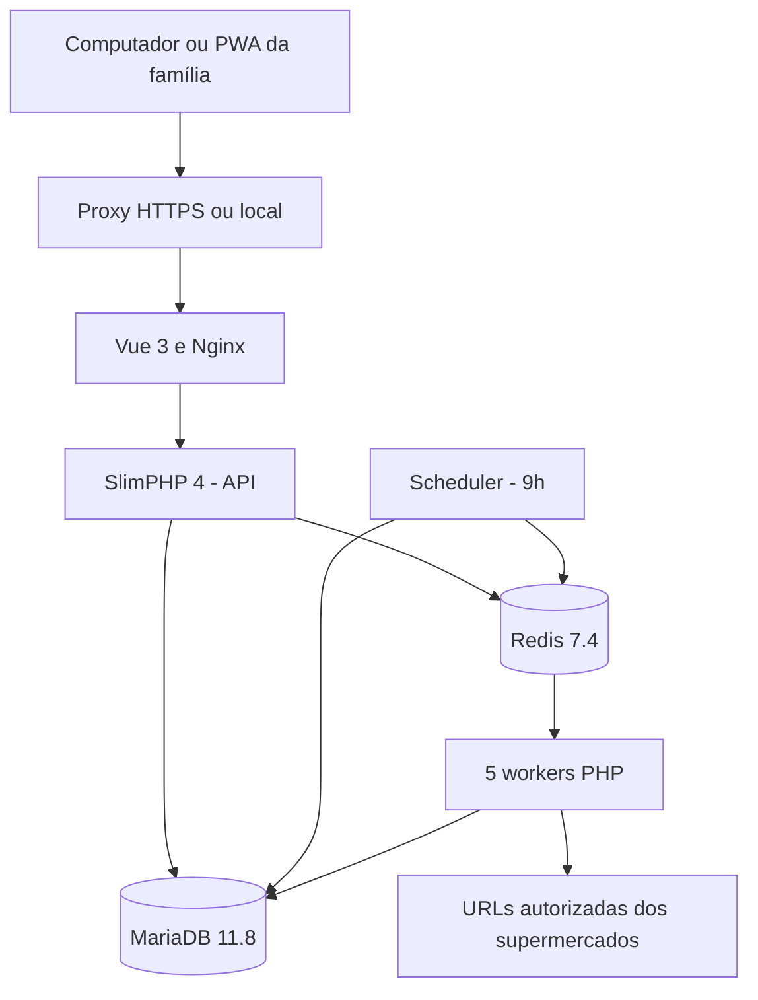

<div align="center">
  

  # ChupaCabra

  **A lista da família. Preços de verdade. Menos trabalho na hora de comprar.**

  Uma aplicação web/PWA para organizar compras compartilhadas, pesquisar preços e atualizar catálogos de supermercados com processos assíncronos — desenvolvida para uso doméstico, publicada para estudo e instalação independente.

       

  [Funcionalidades](#-o-que-o-chupacabra-entrega) · [Instalação](#-instalação-rápida-para-quem-clonou-o-github) · [Fontes de preços](#-cadastro-das-fontes-de-importação) · [Arquitetura](#-como-funciona-por-dentro) · [Problemas resolvidos](#-desafios-de-engenharia-e-decisoes) · [Segurança](#-segurança-e-privacidade)
</div>

---

> [!IMPORTANT]
> **Código público, aplicação privada.** Esta instância é utilizada por uma família, não é um serviço aberto a inscrições nem uma plataforma com contas compartilhadas entre desconhecidos. Para experimentar, faça seu próprio clone, configure seu ambiente e instale localmente. Nenhuma instalação pública ou credencial de demonstração é fornecida.

## 🎯 Por que existe

A maioria das listas de compras começa simples e termina fragmentada: produtos esquecidos, vários celulares com listas diferentes, preços antigos e pouca noção do custo até chegar ao caixa. O ChupaCabra reúne isso em um fluxo só: **planejar → pesquisar → comprar → fechar → analisar**.

O projeto nasceu em uma arquitetura PHP legada baseada em **CodeIgniter 3** e evoluiu para uma solução moderna, com frontend Vue 3, API SlimPHP 4 e raspagem assíncrona com Redis. O objetivo da renovação foi manter os comportamentos úteis da aplicação original sem transformar uma ferramenta familiar em um produto desnecessariamente complexo.

**Escopo intencional:** lista única e compartilhada, autenticação de membros previamente autorizados, supermercados suportados por raspadores específicos. O repositório público não transforma a instalação da família em um serviço multiusuário de terceiros.

## ✨ O que o ChupaCabra entrega

| Área | Funcionalidades |
| --- | --- |
| **Lista compartilhada** | Adicionar/remover itens, quantidades fracionadas, observações, marcar compras, filtros e valores estimados |
| **Catálogo e busca** | Pesquisa por termos/título/categoria, relevância, menor preço cadastrado por produto e fotos |
| **Compra no mercado** | Andamento comprado/restante em barra compacta, estimativa de valor total e valor restante, troca de produtos |
| **Fechamento** | Registrar total do cupom e preservar o retrato financeiro de cada compra; lista volta a ficar disponível |
| **Relatórios** | Comparativo entre custo estimado e efetivamente pago, histórico, detalhes, períodos e visualização mensal |
| **Fontes de importação** | Criar/editar URLs e categorias, ativar/desativar, importar uma fonte, um mercado ou todos, acompanhar filas e erros |
| **Automação** | Agendamento diário às 9h, workers em paralelo, retries, heartbeat, deduplicação, recuperação de falhas |
| **PWA responsivo** | Instalação no celular a partir de um navegador compatível, sem manter um app nativo separado |

As URLs configuradas no banco não são “plugins” arbitrários: **cada supermercado precisa de um raspador próprio no backend**. Esta versão implementa **Confiança** e **Tauste**. Uma loja sem fonte ativa, produtos importados ou itens presentes na lista não aparece nos filtros de compra; permanece gerenciável em **Importações**.

## 🚀 Instalação rápida para quem clonou o GitHub

Esta é a maneira recomendada de experimentar o código **sem Cloudflare, rede externa especial nem certificados da instalação familiar**. O projeto contém um arquivo Compose portátil, separado do Compose de produção privada.

### 1. Pré-requisitos

- Git e **Docker Engine com o plugin Docker Compose v2** (ou Docker Desktop).
- Acesso à internet para baixar imagens e dependências durante o primeiro build.
- Porta **8080** livre em `127.0.0.1` (pode trocar em `.env`).
- Espaço suficiente para imagens de contêiner, banco de dados e eventuais catálogos importados.

Não precisa instalar PHP, Node, Composer, MariaDB ou Redis no computador: tudo é preparado pelo Docker.

### 2. Clone e configure o ambiente

```bash
# Após criar/clonar o repositório na sua conta GitHub:
git clone https://github.com/SEU_USUARIO/SEU_REPOSITORIO.git chupacabra
cd chupacabra
cp .env.example .env
```

No Windows/PowerShell, use `Copy-Item .env.example .env`. Edite `.env` e troque **obrigatoriamente** `DB_PASSWORD`, `DB_ROOT_PASSWORD` e `REDIS_PASSWORD` por senhas fortes e diferentes. Para execução local, mantenha `COOKIE_SECURE=0` porque a URL padrão é HTTP em loopback. Nunca use esse modo exposto diretamente na internet.

O arquivo de exemplo **não contém** contas reais, certificados, tokens de Cloudflare ou banco de dados da família.

### 3. Prepare a autenticação

As contas não são criadas pelo navegador. Cada instalação define seus próprios usuários, e a senha é digitada no terminal, sem salvá-la no comando.

```bash
docker compose -f compose.standalone.yaml build api web
docker compose -f compose.standalone.yaml run --rm --no-deps api php bin/create-users.php usuario1 usuario2
```

Use nomes de usuário de 2 a 80 caracteres (`a-z`, números, ponto, hífen, sublinhado ou `@`). O script solicita uma senha de **pelo menos 12 caracteres para cada pessoa**, usa **Argon2id** e imprime `AUTH_USERS_B64=...`. Copie **a linha inteira** para o `.env` (substitua o campo vazio). O base64 é somente o formato de transporte do JSON de hashes: **não é criptografia nem substitui a proteção do `.env`**.

### 4. Inicialize a aplicação

```bash
docker compose -f compose.standalone.yaml up -d --build
docker compose -f compose.standalone.yaml ps
```

Acesse **http://127.0.0.1:8080** e entre com seu usuário e senha. Não há dados familiares pré-carregados e o catálogo poderá começar vazio — comportamento esperado.

O serviço `migrate` cria/atualiza o esquema antes de liberar a API e os workers. Os volumes persistentes ficam **dentro do diretório do projeto**, em `backend/docker/production/data/db/` e `backend/docker/production/data/redis/`.

Para trocar a porta, defina, por exemplo, `LOCAL_PORT=8090` no `.env` e recrie a stack. Por segurança, o Compose portátil publica a interface **somente em `127.0.0.1`**. Para acessar do celular ou da internet, configure HTTPS e um proxy adequado; não altere essa restrição sem providenciar TLS e proteção de rede.

### 5. Configure os supermercados

Na aplicação: **Importações → Fontes e desempenho → Nova fonte**. Escolha Confiança ou Tauste, defina o nome da categoria e uma URL HTTPS correspondente a esse supermercado. Salve e execute uma importação individual ou geral. O sistema não aceita URLs de domínios arbitrários: a lista `SCRAPE_HOSTS` do `.env` e a validação específica do raspador restringem o acesso.

Se não houver nenhuma URL cadastrada, o agendamento ficará sem fontes para executar. O repositório contém um exemplo histórico de URLs em `backend/docker/production/database/tauste-sources.sql`, mas **não carrega esse arquivo automaticamente**, porque endereços de terceiros podem mudar e devem ser conferidos antes do uso.

### 6. Logs, diagnóstico e desligamento

```bash
# Logs gerais (adicione -f para acompanhar em tempo real)
docker compose -f compose.standalone.yaml logs --tail=100 api worker scheduler

# Verificar integridade e conectividade da API
curl http://127.0.0.1:8080/api/health

# Encerrar sem apagar dados
docker compose -f compose.standalone.yaml down

# Subir novamente preservando banco e sessões
docker compose -f compose.standalone.yaml up -d
```

**Não execute `down -v` ou apague `backend/docker/production/data/` sem ter um backup.** A API requer autenticação para as rotas de negócio; `/api/health` é um indicador técnico de disponibilidade do banco.

## 🔗 Cadastro das fontes de importação

O antigo cadastro manual em `url_search` foi levado para a central web, sem eliminar o controle de segurança do backend.

1. **Cadastrar:** escolha um mercado já implementado, categoria e URL HTTPS; marque se entra no ciclo diário.
2. **Editar:** altere nome da categoria, endereço e estado da fonte, sem alterar seu `uid` ou criar registros duplicados de histórico.
3. **Ativar/desativar:** fontes inativas deixam de gerar tarefas automáticas; tarefas pendentes são marcadas como substituídas. Produtos existentes e compras passadas **não são apagados**.
4. **Excluir:** só é possível excluir uma fonte que nunca produziu histórico de tarefas. Fontes com histórico devem ser desativadas para manter rastreabilidade.
5. **Executar:** dispare uma fonte, um supermercado ou todas as fontes habilitadas. A rotina diária continua independente da ação manual.

A alteração de URL afeta as próximas execuções: **não reescreve produtos já extraídos**. Fontes inválidas, domínios fora da allowlist e supermercados sem scraper retornam erro explícito.

### Estados e desempenho

| Estado | Significado |
| --- | --- |
| `pending` / `queued` | Aguardando despacho ou worker |
| `running` | Executando uma tentativa |
| `retry` | Falha temporária aguardando novo ciclo |
| `success` | Extração concluída com produtos |
| `failed` | Limite de tentativas/erro definitivo |
| `superseded` | Solicitação antiga atendida/substituída sem repetir raspagem |

**Pausa de fila é persistente:** ao pausar, novas tarefas não começam até alguém retomar, incluindo as criadas pelo próximo agendamento. Trabalhos já iniciados terminam. A interface explica esse efeito antes da confirmação.

## 🏗️ Como funciona por dentro



| Camada | Decisão |
| --- | --- |
| Frontend | Vue 3 + Vite; aplicação responsiva, PWA e service worker para recursos estáticos |
| Backend | SlimPHP 4 rodando em PHP 8.5.12 nas imagens de produção |
| Persistência | MariaDB: produtos, lista, compras fechadas, fontes e auditoria de scraping |
| Estado efêmero | Redis: sessões de autenticação e transporte dos IDs da fila |
| Processamento | Cinco workers independentes, um agendador, reprocessamento por erro |
| Infraestrutura | Docker Compose, Nginx e Caddy; Cloudflare Tunnel **opcional e específico da instalação privada** |
| Segurança | Argon2id, sessões no Redis, cookie HTTP-only, CSRF, validação de URL/domínio, consultas parametrizadas |

**Organização:** `backend/src/` contém serviços e raspadores; `backend/public/` expõe a API; `backend/bin/` contém scripts de apoio; `backend/docker/production/database/` traz o esquema; `web/src/` concentra a interface; `web/docker/production/` possui build e servidor web; `docs/` detalha comportamentos e migrações.

O Compose portátil `compose.standalone.yaml` deve ser utilizado por terceiros; o `compose.yaml` original representa a infraestrutura particular e tem dependências externas intencionais.

## 🧠 Desafios de engenharia e decisões

**1. Migrar sem perder o negócio.** O legado CodeIgniter 3 reunia busca, lista e cálculos que precisavam sobreviver à renovação. A interface foi refeita em Vue e a API reorganizada no SlimPHP, mantendo regras essenciais de pesquisa, compra e comparação de preço.

**2. Evitar trabalho duplicado.** Uma fila parada por dias poderia acumular centenas de URLs repetidas. Agora o scheduler consolida solicitações por `source_uid`, as entradas obsoletas são marcadas como `superseded` e o worker exige um bloqueio exclusivo por fonte. Cópias antigas do mesmo ID no Redis são ignoradas, não resultando em novas requisições HTTP.

**3. Recuperar sem multiplicar requisições.** Workers podem cair, reiniciar ou falhar por instabilidade dos sites. Heartbeats, estados por tentativa e agendamento de retry permitem recuperação; o reparo consulta a fila Redis antes de reenfileirar um ID antigo. Extrações vazias não substituem o catálogo válido anterior.

**4. Separar a fila da experiência do usuário.** Raspagem não bloqueia a lista nem depende de navegador aberto. A UI exibe status, duração, quantidade de produtos, histórico e ações manuais, sem expor execução arbitrária de URLs.

**5. Preservar o histórico financeiro.** Ao fechar uma compra, a estimativa de cada item e o total informado no caixa tornam-se um retrato permanente, sem sofrer alterações pelas raspagens de amanhã.

**6. Tornar o projeto reproduzível.** A implantação familiar usa Cloudflare e rede LAN específica; o Compose portátil permite que outra pessoa teste o mesmo produto com sua própria configuração, sem credenciais ou infraestrutura da família.

Mais detalhes: [raspagem](docs/RASPAGEM.md), [regras de compras](docs/COMPRAS.md), [segurança](docs/SEGURANCA.md) e [migração da estrutura](docs/ATUALIZACAO-ESTRUTURA.md).

## 🛡️ Segurança e privacidade

- **Não existem credenciais de demonstração** e nenhuma conta é criada por visitantes. Cada administrador local gera seus usuários no terminal.
- **Não publique** `.env`, `AUTH_USERS_B64`, dados de MariaDB/Redis, certificados, chaves, tokens, backups, exportações ou capturas com informações familiares.
- O frontend e a API utilizam a mesma origem. Mutação de dados requer sessão e token CSRF.
- A lista de domínios autorizados e os raspadores limitam os destinos de coleta; aceitar uma URL no painel não autoriza qualquer site da internet.
- O Compose portátil liga o HTTP **apenas em loopback**. Para acesso de outros dispositivos ou produção, configure HTTPS, cookies seguros, controle de acesso e rede apropriada.
- Respeite os termos dos supermercados, evite sobrecarga por requisições e observe direitos sobre marcas, imagens e outros conteúdos.
- O service worker não disponibiliza catálogo, preços ou lista privada offline; a operação cotidiana requer conexão com a API.

**Sobre licença:** o código é publicamente legível, mas a publicação do repositório **não significa automaticamente concessão de licença para redistribuição ou uso comercial**. Não há `LICENSE` incluída nesta entrega; a escolha de uma licença de código aberto pode ser feita separadamente.

## 🔄 Como atualizar, fazer backup e restaurar

Todos os dados gerados pelo Compose portátil são persistidos abaixo da raiz do clone, e não em volumes anônimos escondidos no Docker. Para backup consistente, **pare os serviços ou faça um dump consistente do MariaDB** antes de copiar os diretórios. Para restauração, retorne `.env` e as pastas `backend/docker/production/data/db/` e `redis/` preservando permissões e use `up -d --build`. A rede do Compose portátil será recriada automaticamente; a rede LAN do ambiente privado exige configuração prévia própria.

```bash
# Atualização de código na instalação portátil
git pull --ff-only
docker compose -f compose.standalone.yaml up -d --build

# Migração explícita, se precisar investigar mudanças de schema
docker compose -f compose.standalone.yaml run --rm migrate
```

Se você usa o Compose original com Cloudflare/LAN, **não substitua suas configurações por valores públicos de exemplo**: mantenha seu `.env`, redes externas, certificados e dados. A migração histórica dos caminhos de armazenamento é detalhada em [docs/ATUALIZACAO-ESTRUTURA.md](docs/ATUALIZACAO-ESTRUTURA.md).

## 🧪 Diagnóstico e testes

Há testes de regras financeiras em `backend/tests/PurchaseHistoryTest.php` e verificações de sintaxe PHP. Em uma instalação clonada, a validação completa ainda deve incluir build do Vue/Vite, API conectada ao MariaDB e Redis, teste do worker com uma categoria real e navegação desktop/mobile.

| Sintoma | O que verificar |
| --- | --- |
| Login não funciona | `AUTH_USERS_B64` gerado, copiado inteiro no `.env` e serviços recriados |
| API fora do ar | `docker compose ... ps`, logs de `api`, `migrate` e saúde do MariaDB |
| Nenhum produto encontrado | Fontes cadastradas e ativas? Importação já terminou com `success`? |
| URL rejeitada | Domínio aceito pelo scraper e incluído em `SCRAPE_HOSTS`; usar HTTPS |
| Fonte não executa | Verificar `enabled`, fila pausada, estado do job e logs de `scheduler`/`worker` |
| Dados desapareceram após reinstalar | Conferir caminho de persistência; **não** inicializar um banco vazio por engano |
| PWA não instala | HTTPS válido fora de localhost, navegador compatível e manifesto carregado |
| Alterou frontend e não mudou | Recriar imagem web e recarregar app; verificar cache de service worker |

## 🧭 Evolução e limites conhecidos

O histórico real anterior à modernização não acompanha este ZIP: a pasta `.git` original recebida estava sem commits. A história **arquitetural** do legado está documentada aqui, mas não foi fabricada uma linha do tempo de commits de 2025 a partir do código de 2026. Novos commits refletem arquivos realmente disponíveis nesta reconstrução.

O foco continua sendo robustez, simplicidade e utilidade para a família; inclusão de novos supermercados exige implementar/testar seus parsers, domínios permitidos e possíveis mudanças de layout nas páginas de terceiros.

---

<div align="center">
  <strong>ChupaCabra</strong> · Projeto familiar e estudo de engenharia full stack

  Criado e mantido por <a href="https://github.com/fabioedusantos">Fábio Eduardo dos Santos</a> · <a href="https://fbsantos.com.br">fbsantos.com.br</a>

  <em>Software útil começa com um problema real. A qualidade aparece na maneira como ele continua funcionando.</em>
</div>
